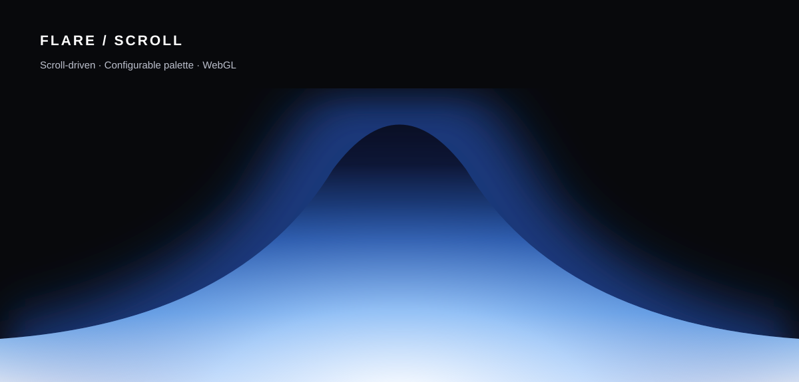

# Flare Scroll

**An organic, scroll-driven light-wave transition with an editable color system.**



Flare Scroll is a dependency-free WebGL effect inspired by a screen-recorded motion reference. It creates two full-screen transitions: a rising wave with a defined central crest, followed by an inverted V-shaped wave. Each color stop follows the curved wavefront, creating a soft, volumetric gradient rather than straight CSS color bands.

**[Interactive playground](demo/index.html)** · [Standalone HTML demo](flare-scroll-standalone.html) · [Implementation skill](SKILL.md) · [Prompt](prompts/implement-flare-scroll.md)

## Features

- **One-color customization.** Supply an accent HEX color; eight intermediate stops are derived automatically between dark and light endpoints.
- **Advanced palette control.** Override all nine HEX stops for art-directed color ramps.
- **Live playground.** Switch between six presets, choose custom colors, tune softness and crest height, and copy a working configuration.
- **Scroll-linked.** Progress is 0–1, reversible and entirely controlled by your page's scroll timeline.
- **No initial glow.** Frame 0 is solid dark; light only enters once scrolling begins.
- **Two organic waves.** Central crest and inverted V contour with configurable amplitude, width and timing.
- **Portable.** One JavaScript file, no build step, no frameworks, Canvas 2D fallback for unavailable WebGL.

### Demo visual language

The playground follows the minimal, dark editorial design system of the [Liquid Metal Border demo](../liquid-metal-border/demo/index.html): a `#121212` canvas, neutral Arial/system typography, large restrained title, thin grey rules, flat surfaces, and compact settings. Color is reserved for the animated wave and its editable swatches. No external fonts are loaded. The renderer itself remains style-agnostic and dependency-free.

## Preview locally

Open [`flare-scroll-standalone.html`](flare-scroll-standalone.html) directly in a browser. The standalone file contains everything, including the renderer.

For the editable split-source version, open [`demo/index.html`](demo/index.html), or serve the project with:

```bash
python3 -m http.server 8080
# Open http://localhost:8080/demo/
```

## Quick start

Include the reusable renderer in any existing HTML project:

```html
<canvas id="flare" aria-hidden="true"></canvas>
<script src="flare-scroll.js"></script>
<script>
  const flare = new FlareScroll(document.querySelector('#flare'), {
    colors: {
      dark: '#000000',
      accent: '#ED5C9C', // <- change ONLY this for a pink wave
      light: '#FFFFFF'
    },
    softness: 1.25,
    crest: 1.0
  });

  const track = document.querySelector('.scroll-track');
  function tick() {
    const rect = track.getBoundingClientRect();
    const distance = Math.max(1, rect.height - window.innerHeight);
    const progress = Math.max(0, Math.min(1, -rect.top / distance));
    flare.resize().setProgress(progress);
    requestAnimationFrame(tick);
  }
  tick();
</script>
```

In your CSS, provide explicit dimensions for the canvas and a tall scroll section:

```css
.scroll-track { height: 490svh; }
.scene { position: sticky; top: 0; height: 100svh; overflow: hidden; }
#flare { position: absolute; inset: 0; width: 100%; height: 100%; }
```

The animation does **not** depend on scroll hijacking, GSAP or an animation library. You can use your own scroll manager, GSAP ScrollTrigger, Lenis, native scroll events or a scrubber; just call `setProgress(0…1)`.

## Color controls

| Setting | Default | Purpose |
|---|---|---|
| `colors.dark` | `#000000` | Starting background / dark side |
| `colors.accent` | `#2E74E2` | Dominant colored light |
| `colors.light` | `#FFFFFF` | Light side of transition |
| `softness` | `1.25` | Overlap and blur of the color bands (`0.55`–`2.4`) |
| `crest` | `1.0` | Height of both organic curves (`0.45`–`1.65`) |
| `pixelRatioCap` | `2` | Upper limit for device pixel ratio |

Changing colors at runtime is immediate:

```js
flare.setColors({ accent: '#FF6496' });
flare.setSoftness(1.65);
flare.setCrest(1.2);
```

For exact art direction, supply all **nine** gradient colors:

```js
flare.setPalette([
  '#000000', '#180714', '#3F1331', '#78234F', '#BD3979',
  '#E868A4', '#F6A8D0', '#FFE2F0', '#FFFFFF'
]);
```

The renderer updates colors as shader uniforms. It does not rebuild the shader whenever a color changes.

## Geometry and timeline

The default geometry reproduces the original motion study. Tune the first and second wave independently when necessary:

```js
const flare = new FlareScroll(canvas, {
  first:  { start: 0.165, end: 0.425, amplitude: 0.64, width: 0.30 },
  second: { start: 0.555, end: 0.820, amplitude: 0.56, width: 0.294 },
  introRevealEnd: 0.15,
  introGuardDistance: 0.66
});
```

- `start` and `end` are normalized scroll progress marks.
- `amplitude` and `width` determine how tall and wide the central curve appears.
- `introRevealEnd` keeps the beginning completely dark; `introGuardDistance` positions the first glow below the viewport before scrolling.
- Text reveals and navigation contrast in the playground are demo-only. The reusable renderer controls only the light-wave canvas.

## API

| Method | Description |
|---|---|
| `new FlareScroll(canvas, options)` | Create a renderer and initialize the WebGL or fallback context |
| `.setProgress(number)` | Render normalized progress `0…1` |
| `.setColors({dark?, accent?, light?})` | Generate an updated nine-stop palette |
| `.setPalette(string[9])` | Use nine explicitly specified HEX colors |
| `.setSoftness(number)` | Modify color blending |
| `.setCrest(number)` | Modify both waves' central height |
| `.resize()` | Match the canvas buffer to its CSS dimensions |
| `.render()` | Draw the current progress |
| `.destroy()` | Release WebGL resources |

Static helpers: `FlareScroll.makePalette(colors)` and `FlareScroll.DEFAULTS`.

## Accessibility and performance

- Treat the canvas as decorative (`aria-hidden="true"`); keep essential content as HTML text.
- The playground respects `prefers-reduced-motion` by disabling scroll-follow interpolation.
- Test text contrast for custom dark/light colors, especially when text overlays the wave.
- Limit pixel ratio on mobile, and call `destroy()` when unmounting in an SPA.
- Prefer a single canvas rather than layered `filter: blur()` backgrounds for the wave itself.
- Canvas 2D fallback approximates the shader at a reduced resolution and may be less smooth than WebGL.

## Project structure

```text
flare-scroll/
├── README.md                       Documentation, setup and API
├── SKILL.md                        Reuse instructions for AI agents
├── src/flare-scroll.js             Standalone renderer
├── demo/index.html                 Styled interactive playground
├── flare-scroll-standalone.html    One-file demo
├── assets/preview.svg              Repository preview
└── prompts/implement-flare-scroll.md
```

## Credits and license

Created as an independent implementation derived from the user's supplied video reference and iterative visual feedback. This is **not** the original source code of the reference website.

Demo UI reviewed using the *Product UI Craft* adaptation of [Unslop by Damir Sokolovsky](https://github.com/heydamir/unslop); the renderer does not bundle Unslop code.

The original implementation and documentation in this folder are distributed under the repository's [MIT license](../../LICENSE).