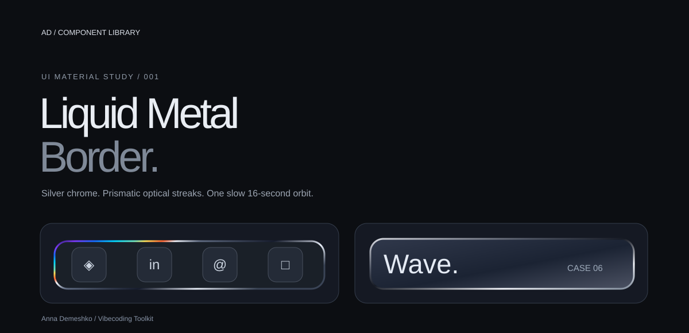

# Liquid Metal Border

**A source-derived UI effect from Anna Demeshko's portfolio**, packaged as a reusable Agent Skill, CSS file, prompt, and visual playground.



[Open live-effect HTML demo](demo/index.html) · [CSS](src/liquid-metal-border.css) · [Implementation prompt](prompts/implement-liquid-metal-border.md)

## Material signature
A thin metallic rim with static silver/graphite reflections and three moving spectral streaks. It has a 16-second orbit and never moves the actual content. Comes from the portfolio's original CSS, not a generic gradient-border generator.

## Modes and quick start
- **Always on:** `liquid-metal-border` (contact dock).
- **Hover + focus:** `liquid-metal-border liquid-metal-border--hover` (portfolio card).
- **Still:** `liquid-metal-border liquid-metal-border--still`.

```html
<link rel="stylesheet" href="src/liquid-metal-border.css">
<div class="liquid-metal-border" style="--lmb-radius:26px;padding:16px">Content</div>
<a class="liquid-metal-border liquid-metal-border--hover" style="--lmb-radius:18px" href="/case">Case</a>
```

Override `--lmb-radius` to the existing element's actual radius, `--lmb-thickness` for border width, `--lmb-duration` for speed (default 16s). All surfaces, layout, content, shadows and icon style remain controlled by your design system.

## Preview
`demo/index.html` is a static HTML demo with live theme switching, hover/focus and motion controls. It loads `../src/liquid-metal-border.css` and has **no dependencies**. Start from the repo root:

```bash
python3 -m http.server 8000
# http://localhost:8000/skills/liquid-metal-border/demo/
```

The SVG here is an illustrative thumbnail; the live HTML shows the real animated CSS. For a fuller archived study and PNG thumbnail, download the complete private ChatGPT skill bundle.

## Quality checks
- The ring stays hollow and pointer-transparent.
- Mostly silver; colored streaks only cover a minority of the border.
- Hover/focus card stays inactive until activated.
- Animates the registered angle instead of rotating or scaling the card.
- Respects `prefers-reduced-motion`. Legacy browsers get a silver border.
- If the host already uses `::before` / `::after`, wrap it.

## Source
Original code: [en-theme-parity.css](https://github.com/annademeshko/annademeshko.github.io/blob/main/en-theme-parity.css), [en-bilingual-parity.css](https://github.com/annademeshko/annademeshko.github.io/blob/main/en-bilingual-parity.css) and [contact-glass.css](https://github.com/annademeshko/annademeshko.github.io/blob/main/contact-glass.css). The last credits the Libraries.dev border beam pattern. The full-screen GPU theme reveal is a DIFFERENT effect and is not included.